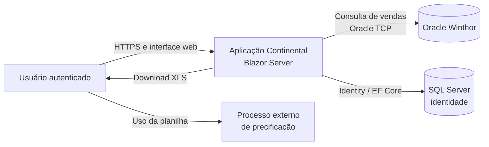
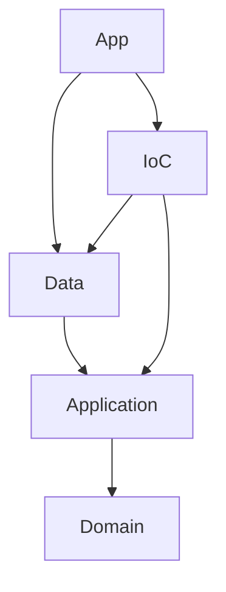

# Documento de Arquitetura de Software (DAS)

## 1. Identificação e propósito

| Item | Descrição |
| --- | --- |
| Sistema | Sistema Exportador de Planilhas para Precificação — Continental Sistemas |
| Versão do documento | 1.0 |
| Data | 23/11/2026 |
| Estado | Retrato da implementação existente no repositório, sujeito a atualização conforme o código evoluir. |
| Público | Desenvolvimento, arquitetura, operação, segurança, homologação e responsáveis pelo negócio. |

Este documento descreve o contexto, a estrutura, os fluxos, as integrações, as decisões e as limitações arquiteturais da aplicação. Seu escopo é o código e a documentação presentes no repositório; uma característica descrita como meta, risco ou recomendação não deve ser interpretada como funcionalidade já implementada ou resultado homologado.

## 2. Contexto e objetivos

O sistema permite que um usuário autenticado informe números de vendas do ERP Winthor, consulte os dados no Oracle, revise os itens e gere uma planilha `.xls` para o processo de precificação. A proposta é reduzir a dependência de intervenção técnica para preparar os dados usados pelas lojas e pelo Financeiro.

O escopo implementado compreende autenticação, consulta de vendas não canceladas, identificação de números ausentes, pré-visualização e download de planilha. O sistema não atualiza vendas no Winthor nem executa modelos de inteligência artificial. A utilização posterior da planilha pertence ao processo externo de negócio.

### 2.1 Contexto do sistema



O diagrama representa as dependências lógicas, não uma topologia de produção validada. A conectividade com o Oracle pode depender de rede corporativa ou VPN; o repositório não estabelece uma configuração de rede específica.

## 3. Requisitos e restrições relevantes

### 3.1 Funcionalidades

| Identificador | Comportamento implementado |
| --- | --- |
| F01 | Restringir `/extracao-vendas` a usuários autenticados. |
| F02 | Receber destino Winthor, data e complemento do arquivo, e números das vendas. |
| F03 | Aceitar de 1 a 1.000 números distintos, inteiros e positivos; remover duplicatas. |
| F04 | Verificar a existência de vendas não canceladas antes de consultar itens. Se houver vendas ausentes ou canceladas, exibi-las e não gerar o resultado. |
| F05 | Apresentar os itens consultados e os totais de quantidade e custo. |
| F06 | Gerar em memória e disponibilizar para download um arquivo Excel no formato `.xls`. |
| F07 | Registrar durações e resultados; em compilação Debug, exibir diagnóstico de recursos após a consulta. |

### 3.2 Restrições e regras de negócio

- A data informada compõe o nome do arquivo, **não** filtra a consulta. O destino disponível é Winthor.
- Vendas são separadas por vírgula, ponto e vírgula, espaço ou quebra de linha; a entrada também aceita tabulação.
- A consulta de itens agrupa por código do produto, descrição, referência e preço de venda; uma linha da planilha não representa necessariamente uma venda individual. Pedidos com `POSICAO = 'C'` não são considerados; a condição SQL `<> 'C'` também não seleciona valores nulos.
- O custo unitário apresentado corresponde a `NVL(I.PVENDA, 0)`; o custo total é a soma da quantidade multiplicada por esse valor. `PRO_CODIGO` e `VENDA` são vazios e `PRECO_LOJA` é exportado como zero.
- O arquivo tem cabeçalho e até 65.535 linhas de itens. Não é exportado se não houver itens ou se o limite for excedido. O nome segue o padrão `<complemento>_Winthor_<dd.MM.yyyy>.xls`.
- As metas de desempenho são objetivos de homologação, não garantias. O README propõe avaliar `ConsultaELeituraItens` abaixo de 5.000 ms em ambiente apropriado.

## 4. Visão arquitetural

### 4.1 Estilo e organização

A solução é uma aplicação web ASP.NET Core em camadas, com componentes Razor em modo **Interactive Server**. A interface e a lógica de negócio executam no servidor; o navegador mantém um circuito interativo e utiliza JavaScript para receber o arquivo. É uma aplicação lógica única, não uma arquitetura de microsserviços.

A organização é inspirada em DDD, mas o projeto `Domain` está preparado e ainda não contém um modelo de domínio rico. Regras de validação e coordenação do fluxo também estão na página; a geração de planilha está no serviço de aplicação.

| Projeto | Responsabilidade atual | Exemplos |
| --- | --- | --- |
| `ContinentalSistemas.App` | Hospedagem, UI, autenticação, configuração, diagnóstico e download. | `Program.cs`, `ExtracaoVendas.razor`, `MonitorCircuito`, `extracao-vendas.js` |
| `ContinentalSistemas.Application` | Contratos, DTOs, operações de aplicação e geração da planilha. | `IExtracaoVendasService`, `IWinthorVendasRepository`, `ExtracaoVendasService` |
| `ContinentalSistemas.Domain` | Projeto reservado ao domínio; atualmente sem entidades ou regras implementadas. | `ContinentalSistemas.Domain.csproj` |
| `ContinentalSistemas.Data` | Acesso Oracle e persistência de identidade. | `WinthorVendasRepository`, `VendaWinthorQueries`, `ApplicationDbContext` |
| `ContinentalSistemas.Ioc` | Composição dos serviços e repositórios por injeção de dependência. | `Dependencyinjection.cs` |

### 4.2 Dependências entre projetos



As setas representam referências de projeto. Em tempo de execução, a página usa `IExtracaoVendasService`; `ExtracaoVendasService` depende de `IWinthorVendasRepository`, implementado em `Data`. Serviço e repositório são registrados com tempo de vida *scoped*. `App` referencia `Data` também para compor o Identity; portanto, a interface não está totalmente isolada da infraestrutura na composição da aplicação.

## 5. Visão de execução

### 5.1 Consulta e exportação

```mermaid
sequenceDiagram
	actor U as Usuário
	participant UI as Página Blazor
	participant S as Serviço de extração
	participant R as Repositório Winthor
	participant O as Oracle
	participant J as JavaScript do navegador
	U->>UI: Informa parâmetros e solicita consulta
	UI->>UI: Valida entradas e configuração do host
	UI->>S: Obter números inexistentes
	S->>R: Obter números existentes
	R->>O: Consultar PCPEDC com parâmetros
	O-->>R: Números não cancelados
	R-->>S: Números existentes
	S-->>UI: Números ausentes
	alt Há números ausentes
		UI-->>U: Exibe aviso; não extrai itens
	else Todos encontrados
		UI->>S: Extrair itens
		S->>R: Consultar itens
		R->>O: Consultar e agrupar PCPEDI, PCPEDC e PCPRODUT
		O-->>UI: Itens via repositório e serviço
		UI-->>U: Pré-visualização
		U->>UI: Solicita exportação
		UI->>S: Gerar XLS em memória
		S-->>UI: Bytes da planilha
		UI->>J: Enviar stream e solicitar download
		J-->>U: Acionar download no navegador
	end
```

As duas consultas Oracle abrem conexões separadas e não compartilham uma transação explícita. Alterações nos dados entre a verificação e a leitura de itens podem afetar a consistência do resultado. O código configura tempo limite de **30 segundos por comando**; não há política explícita de repetição nesse fluxo.

A página registra exceções de consulta/exportação e apresenta mensagem ao usuário. Após o retorno bem-sucedido da chamada JavaScript, o formulário e o resultado são limpos. Esse retorno indica que o navegador foi instruído a baixar o arquivo, não confirma que o usuário o salvou em disco.

### 5.2 Dados e integrações

| Recurso | Uso e contrato |
| --- | --- |
| Oracle Winthor | Leitura dos pedidos e itens por `Oracle.ManagedDataAccess.Core`. O destino é montado com host configurado, porta TCP 1521 e SID. As vendas são vinculadas como parâmetros; não são concatenadas como valores SQL. |
| `PCPEDC` | Verificação dos números e filtro dos pedidos não cancelados. |
| `PCPEDI` e `PCPRODUT` | Itens, preços e atributos dos produtos usados na consulta agrupada. |
| SQL Server | Armazenamento do ASP.NET Core Identity via EF Core; LocalDB é a configuração padrão documentada para desenvolvimento. Não armazena as planilhas geradas pelo fluxo de extração. |
| Arquivo `.xls` | Gerado por NPOI em memória, com cabeçalho `PRO_CODIGO`, `COD_R3MAGAZINE`, `PRO_DESCRICAO`, `PRO_REFERENCIA`, `QUANTIDADE`, `VENDA`, `CUSTO`, `PRECO_LOJA` e `CUSTO_TOTAL`. |
| Navegador | Recebe o stream, cria um Blob com MIME `application/vnd.ms-excel` e aciona um link de download. |

Os resultados consultados e o arquivo gerado são mantidos em memória durante o fluxo; não há arquivo temporário de planilha gravado pelo código. O uso de memória e a renderização da tabela podem crescer com o volume de itens e a quantidade de usuários simultâneos.

## 6. Tecnologias e configuração

| Elemento | Tecnologia identificada |
| --- | --- |
| Plataforma | C# / .NET 10 |
| Interface e servidor web | ASP.NET Core Razor Components, Blazor Interactive Server, Bootstrap |
| Identidade e persistência | ASP.NET Core Identity, Entity Framework Core e SQL Server |
| Oracle | `Oracle.ManagedDataAccess.Core` 23.26.401 |
| Planilha | NPOI 2.8.1, formato HSSF/XLS |
| Testes | NUnit; projetos de testes de aplicação e dados |

A aplicação requer `ConnectionStrings:DefaultConnection` para o Identity e `WinthorOracle:Host`, `UserId`, `Password` e `SID` para o acesso ao Oracle. Os nomes de variáveis de ambiente usam `__` como separador, por exemplo `WinthorOracle__Host`. Não inclua credenciais em arquivos versionados; use User Secrets em desenvolvimento e um mecanismo protegido no ambiente implantado. Consulte os comandos e pré-requisitos no [README](../README.md#configuração-local).

Na inicialização, o sistema aplica automaticamente as migrações do Identity e provisiona um usuário inicial se ele não existir. O banco de identidade deve estar acessível e permitir as operações necessárias. A aplicação não contém, no repositório, uma topologia de implantação ou infraestrutura de produção comprovada.

## 7. Segurança e privacidade

### 7.1 Controles presentes

- A página de extração usa `[Authorize]`; o Identity utiliza cookies e exige conta com e-mail confirmado para entrar.
- O pipeline configura autenticação, autorização, antifalsificação e redirecionamento HTTPS; fora de Development também configura HSTS e página de erro.
- As consultas de vendas usam parâmetros Oracle para os números informados. Os registros de desempenho não precisam conter esses números ou credenciais.
- A página exibe mensagens de erro genéricas e registra detalhes da exceção no servidor.

### 7.2 Limitações e ações antes da implantação

- **Credencial inicial fixa no código:** `Program.cs` cria a conta inicial com senha definida na implementação. Substituir por provisionamento seguro antes de implantar; se a senha tiver sido utilizada, alterá-la. Não reproduzir essa credencial na documentação.
- O envio de e-mail está registrado como `IdentityNoOpEmailSender`; fluxos que dependem de entrega de confirmação ou recuperação precisam de um provedor real e de validação operacional.
- A página exige autenticação, mas o código não define nela uma política de autorização específica para extração. Avaliar perfil de acesso, menor privilégio e auditoria conforme a organização.
- A string Oracle usa TCP; não se deve presumir criptografia de transporte para essa conexão. Validar proteção da rede e configurar transporte seguro conforme as capacidades do ambiente.
- Proteger credenciais, configuração, logs e dados da planilha; restringir o usuário Oracle às permissões de leitura necessárias. Avaliar retenção e classificação dos dados.

## 8. Observabilidade e qualidade

### 8.1 Logs e diagnósticos

O repositório registra tempo de abertura de conexão e de execução **com leitura** para cada consulta. A página registra duração total da consulta e, separadamente, duração de geração e transferência da planilha; também coleta amostras de memória no fluxo de exportação. `extracaoId` e `circuitoId` permitem correlação; a exibição de escopos do provedor de console precisa ser habilitada quando desejada. `MonitorCircuito` registra abertura, desconexão, reconexão e encerramento do circuito.

Em compilação **Debug**, a página apresenta ao final da consulta o resultado, os horários, a duração, o tempo de CPU, o percentual médio de CPU normalizado por processadores lógicos e a memória privada e residente no início e no fim. A coleta também cobre erro e vendas inexistentes, quando possível. Esses números de CPU e memória são do **processo inteiro**, incluindo outros usuários; as amostras não comprovam o pico. A duração da consulta não inclui renderização ou exportação. O painel não é habilitado apenas por selecionar o ambiente Development.

### 8.2 Testes e validação

Os projetos `tests/ContinentalSistemas.Application.tests` e `tests/ContinentalSistemas.Data.tests` possuem testes NUnit. Eles exercitam, respectivamente, regras do serviço e conteúdo da planilha, e entradas/configuração do repositório e estrutura das consultas. Comandos de execução estão no [README](../README.md#testes).

Esses testes não substituem validação de ponta a ponta com autenticação, navegador e Oracle, nem testes de carga, concorrência, rede/VPN e recuperação. A meta de menos de 5.000 ms para a etapa de consulta e leitura dos itens deve ser medida em homologação com dados e condições representativas; não há evidência no código que a garanta.

## 9. Decisões arquiteturais observadas

| Decisão | Consequência e limite |
| --- | --- |
| Blazor Interactive Server | Simplifica integração da UI com serviços .NET, mas mantém estado e comunicação do circuito no servidor e depende de conectividade durante a interação. |
| Contrato de repositório na aplicação | Permite testar o serviço sem Oracle; o SQL e o driver ficam na infraestrutura. |
| Validar pedidos antes de consultar itens | Evita exportar parcialmente quando números estão ausentes; duas leituras separadas não garantem snapshot consistente. |
| XLS em memória | Dispensa arquivo temporário no servidor e preserva compatibilidade com o processo atual; impõe limites do formato e consumo de memória. |
| Identity em SQL Server separado do Oracle | Isola o armazenamento de identidade dos dados de vendas, mas adiciona dependência de disponibilidade e migração na inicialização. |
| Instrumentação por logs e painel Debug | Apoia diagnóstico, mas métricas de processo não atribuem recursos a uma única consulta e não substituem monitoramento externo. |

Estas decisões são inferidas da implementação, não um histórico formal de alternativas ou aprovações.

## 10. Riscos e pontos pendentes

| Ponto | Impacto ou validação necessária |
| --- | --- |
| Segurança do provisionamento inicial e envio de e-mail | Substituir a senha fixa, configurar envio real e validar os fluxos de conta antes de produção. |
| Alterações entre as duas consultas | Avaliar com o negócio se é necessário isolamento consistente ou nova verificação antes da exportação. |
| Dependência de bancos e rede | Validar disponibilidade, timeouts, recuperação operacional e conectividade com Oracle e SQL Server. |
| Escala e memória | Medir tamanhos de consultas, arquivo, múltiplos circuitos e usuários simultâneos; definir capacidade e limites operacionais. |
| Desempenho | Medir a meta documentada com dados reais representativos, índices e plano de execução, sem presumir seu atendimento. |
| Operação | Definir implantação, observabilidade centralizada, proteção e retenção de logs, backup do Identity e procedimentos de recuperação. |
| Cobertura de ponta a ponta | Exercitar login, consulta Oracle, falhas, resultados vazios e download com dados e permissões de homologação. |

## 11. Referências e rastreabilidade

- [README do projeto](../README.md): configuração, execução, testes, métricas e advertências operacionais.
- [Relatório do Projeto Aplicado](../Relat%C3%B3rio%20do%20Projeto%20Aplicado%20-%20Francisco%20Gleidson%20da%20Silva%20Freitas.pdf): contexto do negócio e evidências apresentadas no projeto.
- Código: `src/ContinentalSistemas.App/Program.cs`, `Components/Pages/ExtracaoVendas.razor`, `Diagnostics/MonitorCircuito.cs` e `wwwroot/js/extracao-vendas.js`.
- Código: `src/ContinentalSistemas.Application/Services/ExtracaoVendasService.cs`, contratos de aplicação, `src/ContinentalSistemas.Data/Repositories/WinthorVendasRepository.cs`, `WinthorQueries/VendaWinthorQueries.cs` e `src/ContinentalSistemas.Ioc/Dependencyinjection.cs`.
- Testes: `tests/ContinentalSistemas.Application.tests` e `tests/ContinentalSistemas.Data.tests`.
